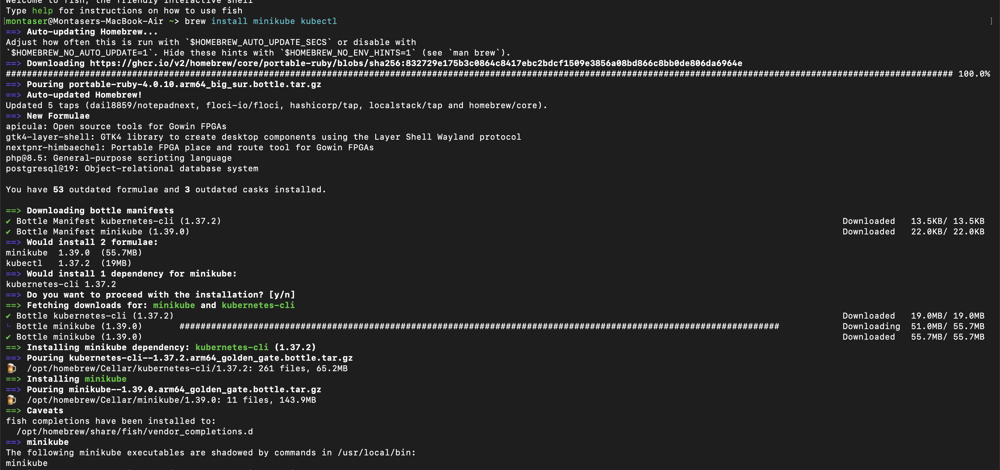
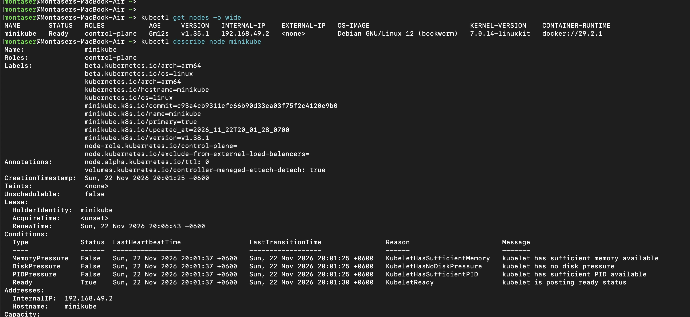
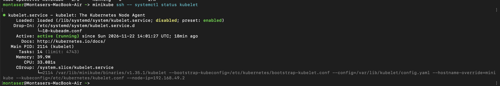
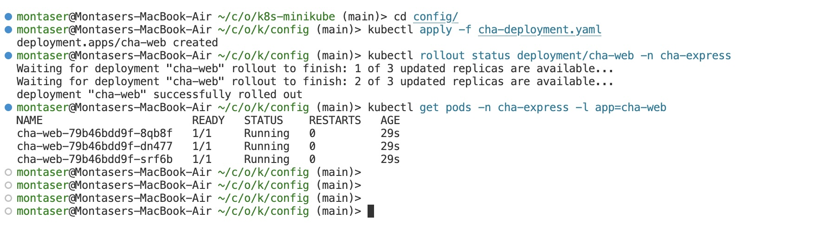
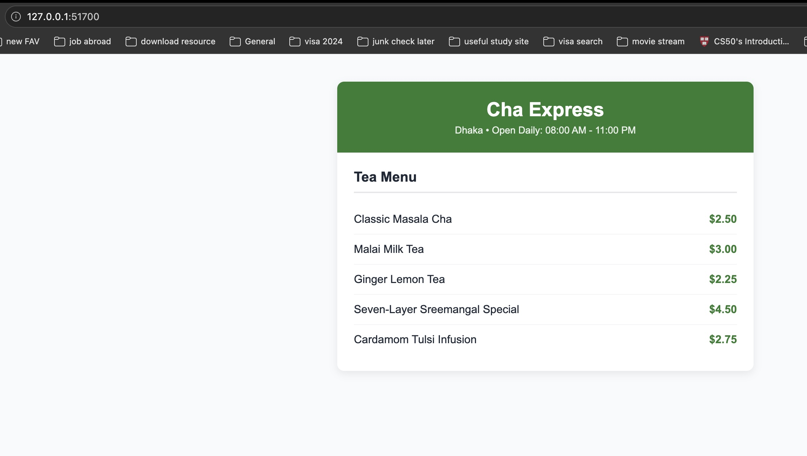

# Task 1: Cluster & Namespace


## Minikube Setup & Cluster Configuration Guide

Run Kubernetes locally on macOS with Minikube.

---

## Prerequisites

- **OS:** macOS (Intel or Apple Silicon)
- **Resources:** Minimum 2 CPUs, 2 GB free RAM, 20 GB free disk space
- **Driver:** Container or VM manager installed and running (e.g., [Docker Desktop](https://www.docker.com/products/docker-desktop/), HyperKit, or QEMU)
- **Package Manager:** [Homebrew](https://brew.sh/)

## 1. Install Minikube

Install `minikube` and `kubectl` with Homebrew:

```bash
brew install minikube kubectl
```



## 2. Start the Cluster

```bash
minikube start --driver=docker
```


## 3. Verify the Cluster

Check the overall Minikube status:

```bash
minikube status
```


View a summary of the cluster nodes:

```bash
kubectl get nodes -o wide
```

View the full specifications, capacity, and conditions for the Minikube node:

```bash
kubectl describe node minikube
```




## 4. Create the Namespace

Create the `cha-express` namespace to isolate all subsequent application resources:

```bash
kubectl create namespace cha-express
```

Verify that the namespace was created:

```bash
kubectl get namespaces
```

Set `cha-express` as the default namespace for your current kubectl context:

```bash
kubectl config set-context --current --namespace=cha-express
```


## 5. Control Plane Components

In a Minikube cluster, the core Kubernetes control plane components run as pods inside the kube-system namespace.

List all running system pods to inspect them:

```bash
kubectl get pods -n kube-system
```


Check the kubelet service status inside the Minikube virtual machine:

```bash
minikube ssh -- systemctl status kubelet
```




# Task 2: ConfigMap

## 1. ConfigMap

Create the `cha-config` ConfigMap in the `cha-express` namespace. The manifest contains environment key-value pairs and the `index.html` file:

[View cha-config.yaml](./config/cha-config.yaml)

### Apply and verify the ConfigMap

Run the following commands to create and inspect the ConfigMap inside cha-express:

```bash
kubectl apply -f config/cha-config.yaml
kubectl get configmap cha-config -n cha-express
kubectl describe configmap cha-config -n cha-express
```


# Task 3: Secret

### Secret `cha-secret` and secret encryption

### 1. Create the `cha-secret` Secret

Create a manifest named `cha-secret.yaml` in the `cha-express` namespace with dummy values for `ADMIN_PASSWORD` and `PAYMENT_API_KEY`:

[View cha-secret.yaml](./config/cha-secret.yaml)

Apply and inspect the Secret:

```bash
kubectl apply -f config/cha-secret.yaml
kubectl get secret cha-secret -n cha-express
kubectl describe secret cha-secret -n cha-express
```


### 2. Are Kubernetes Secrets encrypted?

By default, no. Kubernetes Secrets are only base64-encoded, not encrypted at rest in etcd. Encryption at rest is optional and must be explicitly enabled on the cluster with an `EncryptionConfiguration` passed to `kube-apiserver`, using providers such as `aescbc`, `secretbox`, or a KMS provider.

Fetch and decode a Secret value to demonstrate that base64 encoding is reversible:

```bash
kubectl get secret cha-secret -n cha-express -o jsonpath='{.data.ADMIN_PASSWORD}' | base64 -d && echo
```


# Task 4: Deployment & Service

### 1. Create the Deployment (`cha-deployment.yaml`)

This Deployment runs `nginx:1.25-alpine` with **3 replicas** inside the `cha-express` namespace, loads all keys from `cha-config` via `envFrom`, injects only `ADMIN_PASSWORD` from `cha-secret`, mounts `index.html` from `cha-config` into Nginx's web root (`/usr/share/nginx/html/index.html`), and defines CPU and memory resource requests and limits.

[View cha-deployment.yaml](./config/cha-deployment.yaml)


Apply and verify the Deployment:

```bash
kubectl apply -f config/cha-deployment.yaml
kubectl rollout status deployment/cha-web -n cha-express
kubectl get pods -n cha-express -l app=cha-web
```




### 2. Create the NodePort Service

Create a NodePort Service targeting the `cha-web` pods on port 80 and exposing external node port 30080:

[View cha-service.yaml](./config/cha-service.yaml)

Apply and inspect the Service:

```bash
kubectl apply -f config/cha-service.yaml
kubectl get svc cha-web-service -n cha-express
```


### 3. Open Cha Express in a Browser

On macOS with the Minikube Docker driver, open a tunnel and launch the menu page in your browser:

```bash
minikube service cha-web-service -n cha-express
```





