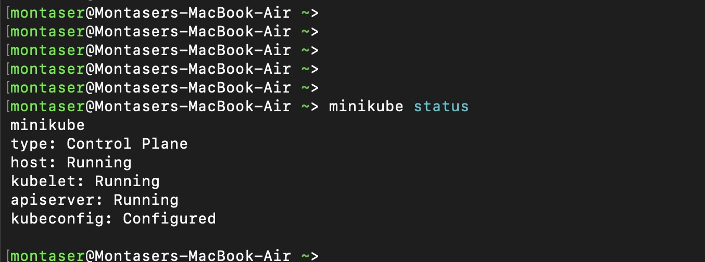
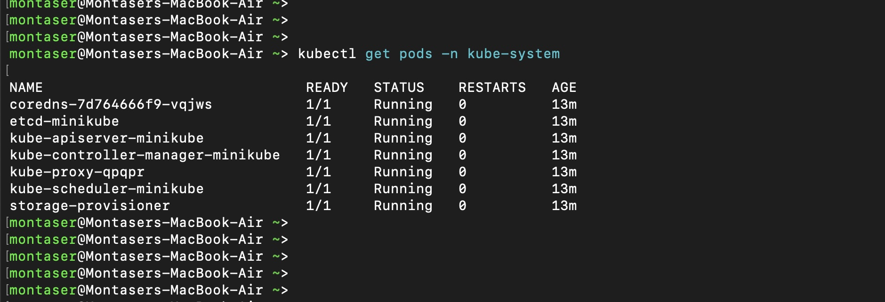
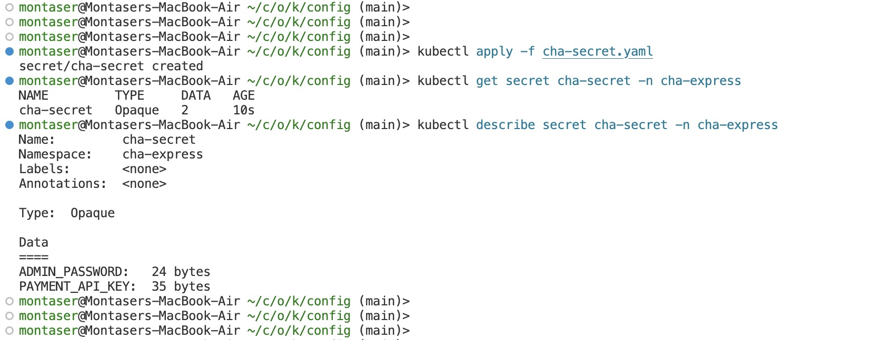

### Task 1: Cluster & Namespace 
# Minikube Setup & Cluster Configuration Guide

Run Kubernetes locally on macOS with Minikube.

---

## Prerequisites

- **OS:** macOS (Intel or Apple Silicon)
- **Resources:** Minimum 2 CPUs, 2 GB free RAM, 20 GB free disk space
- **Driver:** Container or VM manager installed and running (e.g., [Docker Desktop](https://www.docker.com/products/docker-desktop/), HyperKit, or QEMU)
- **Package Manager:** [Homebrew](https://brew.sh/)

## 1. Install Minikube

Install `minikube` and `kubectl` with Homebrew:

```bash
brew install minikube kubectl
```

## 2. Start the Cluster

```bash
minikube start --driver=docker

```


## 3. Verify the Cluster

Check the overall Minikube status:

```bash
minikube status
```



View a summary of the cluster nodes:

```bash
kubectl get nodes -o wide
```

View the full specifications, capacity, and conditions for the Minikube node:

```bash
kubectl describe node minikube
```


## 4. Create the Namespace

Create the `cha-express` namespace to isolate all subsequent application resources:

```bash
kubectl create namespace cha-express
```

Verify that the namespace was created:

```bash
kubectl get namespaces
```

Set `cha-express` as the default namespace for your current kubectl context:

```bash
kubectl config set-context --current --namespace=cha-express
```


## 5. Control Plane Components

In a Minikube cluster, the core Kubernetes control plane components run as pods inside the kube-system namespace.

List all running system pods to inspect them:

```bash
kubectl get pods -n kube-system
```



kubelet status


```bash
minikube ssh -- systemctl status kubelet
```


### Task 2: ConfigMap

To create the cha-config ConfigMap in the cha-express namespace containing both the environment key-value pairs and the index.html file, apply the following YAML manifest using kubectl.
1. Create the Manifest 


2. Apply and Verify the ConfigMap
Run the following commands to create and inspect the ConfigMap inside cha-express:

```bash

kubectl apply -f cha-config.yaml
kubectl get configmap cha-config -n cha-express
kubectl describe configmap cha-config -n cha-express

```


### Task 3: Secret


# Secret `cha-secret` and Secret Encryption in Kubernetes

## 1. Create the `cha-secret` Secret

Create a manifest named `cha-secret.yaml` in the `cha-express` namespace with dummy values for `ADMIN_PASSWORD` and `PAYMENT_API_KEY`:


Apply and inspect the Secret:


```bash

kubectl apply -f cha-secret.yaml
kubectl get secret cha-secret -n cha-express
kubectl describe secret cha-secret -n cha-express

```



