# Task 1: Cluster & Namespace


## Minikube Setup & Cluster Configuration Guide

Run Kubernetes locally on macOS with Minikube.

---

## Prerequisites

- **OS:** macOS (Intel or Apple Silicon)
- **Resources:** Minimum 2 CPUs, 2 GB free RAM, 20 GB free disk space
- **Driver:** Container or VM manager installed and running (e.g., [Docker Desktop](https://www.docker.com/products/docker-desktop/), HyperKit, or QEMU)
- **Package Manager:** [Homebrew](https://brew.sh/)

## 1. Install Minikube

Install `minikube` and `kubectl` with Homebrew:

```bash
brew install minikube kubectl
```


## 2. Start the Cluster

```bash
minikube start --driver=docker
```

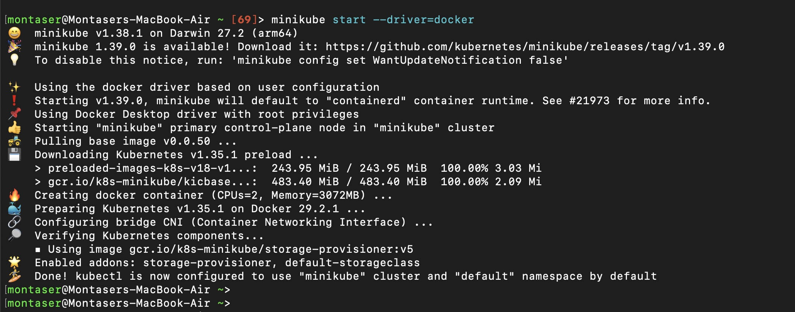
## 3. Verify the Cluster

Check the overall Minikube status:

```bash
minikube status
```


View a summary of the cluster nodes:

```bash
kubectl get nodes -o wide
```

View the full specifications, capacity, and conditions for the Minikube node:

```bash
kubectl describe node minikube
```


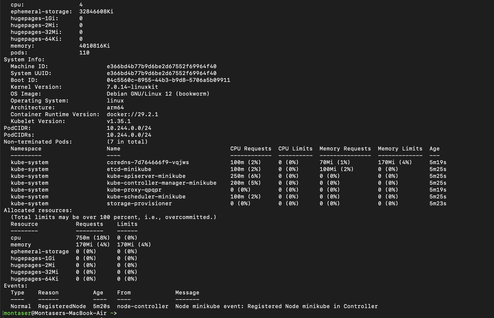
## 4. Create the Namespace

Create the `cha-express` namespace to isolate all subsequent application resources:

```bash
kubectl create namespace cha-express
```

Verify that the namespace was created:

```bash
kubectl get namespaces
```

Set `cha-express` as the default namespace for your current kubectl context:

```bash
kubectl config set-context --current --namespace=cha-express
```

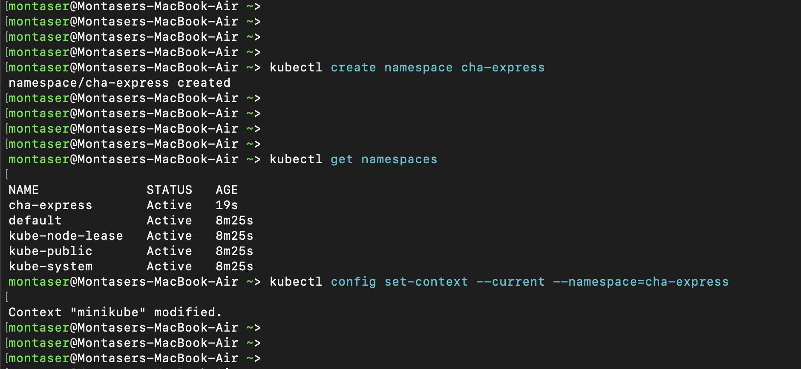

## 5. Control Plane Components

In a Minikube cluster, the core Kubernetes control plane components run as pods inside the kube-system namespace.

List all running system pods to inspect them:

```bash
kubectl get pods -n kube-system
```


Check the kubelet service status inside the Minikube virtual machine:

```bash
minikube ssh -- systemctl status kubelet
```


# Task 2: ConfigMap

## 1. ConfigMap

Create the `cha-config` ConfigMap in the `cha-express` namespace. The manifest contains environment key-value pairs and the `index.html` file:

[View cha-config.yaml](./config/cha-config.yaml)

### Apply and verify the ConfigMap

Run the following commands to create and inspect the ConfigMap inside cha-express:

```bash
kubectl apply -f config/cha-config.yaml
kubectl get configmap cha-config -n cha-express
kubectl describe configmap cha-config -n cha-express
```

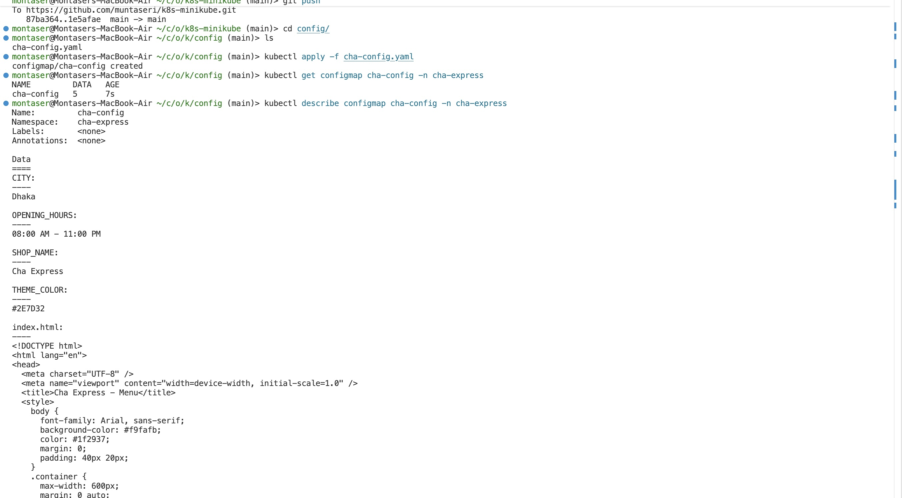


# Task 3: Secret

### Secret `cha-secret` and secret encryption

### 1. Create the `cha-secret` Secret

Create a manifest named `cha-secret.yaml` in the `cha-express` namespace with dummy values for `ADMIN_PASSWORD` and `PAYMENT_API_KEY`:

[View cha-secret.yaml](./config/cha-secret.yaml)

Apply and inspect the Secret:

```bash
kubectl apply -f config/cha-secret.yaml
kubectl get secret cha-secret -n cha-express
kubectl describe secret cha-secret -n cha-express
```


### 2. Are Kubernetes Secrets encrypted?

By default, no. Kubernetes Secrets are only base64-encoded, not encrypted at rest in etcd. Encryption at rest is optional and must be explicitly enabled on the cluster with an `EncryptionConfiguration` passed to `kube-apiserver`, using providers such as `aescbc`, `secretbox`, or a KMS provider.

Fetch and decode a Secret value to demonstrate that base64 encoding is reversible:

```bash
kubectl get secret cha-secret -n cha-express -o jsonpath='{.data.ADMIN_PASSWORD}' | base64 -d && echo
```

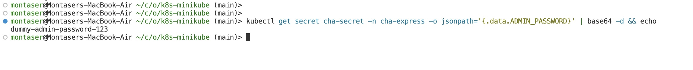

# Task 4: Deployment & Service

### 1. Create the Deployment (`cha-deployment.yaml`)

This Deployment runs `nginx:1.25-alpine` with **3 replicas** inside the `cha-express` namespace, loads all keys from `cha-config` via `envFrom`, injects only `ADMIN_PASSWORD` from `cha-secret`, mounts `index.html` from `cha-config` into Nginx's web root (`/usr/share/nginx/html/index.html`), and defines CPU and memory resource requests and limits.

[View cha-deployment.yaml](./config/cha-deployment.yaml)


Apply and verify the Deployment:

```bash
kubectl apply -f config/cha-deployment.yaml
kubectl rollout status deployment/cha-web -n cha-express
kubectl get pods -n cha-express -l app=cha-web
```


### 2. Create the NodePort Service

Create a NodePort Service targeting the `cha-web` pods on port 80 and exposing external node port 30080:

[View cha-service.yaml](./config/cha-service.yaml)

Apply and inspect the Service:

```bash
kubectl apply -f config/cha-service.yaml
kubectl get svc cha-web-service -n cha-express
```

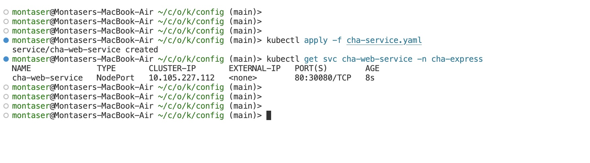

### 3. Open Cha Express in a Browser

On macOS with the Minikube Docker driver, open a tunnel and launch the menu page in your browser:

```bash
minikube service cha-web-service -n cha-express
```

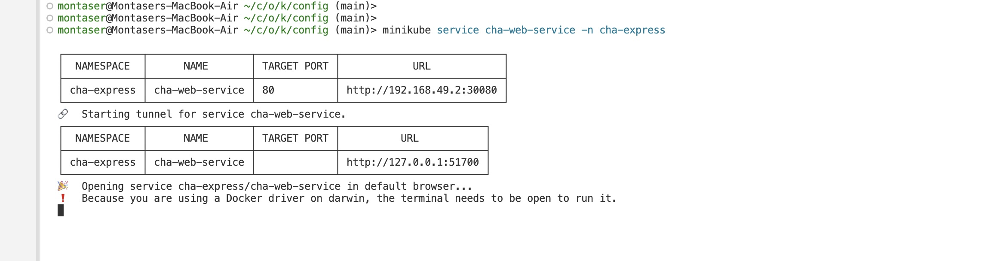


### 4. Proof That Environment Variables Are Available Inside the Container

Execute printenv inside one of the running cha-web pods to verify that:
All key-value pairs from cha-config (SHOP_NAME, CITY, THEME_COLOR, OPENING_HOURS) are present.
ADMIN_PASSWORD from cha-secret is present.

PAYMENT_API_KEY from cha-secret is not injected.


```bash

POD_NAME=$(kubectl get pods -n cha-express -l app=cha-web -o jsonpath='{.items[0].metadata.name}')

kubectl exec -n cha-express "$POD_NAME" -- sh -c \
  'echo "SHOP_NAME=$SHOP_NAME"; \
   echo "CITY=$CITY"; \
   echo "THEME_COLOR=$THEME_COLOR"; \
   echo "OPENING_HOURS=$OPENING_HOURS"; \
   echo "ADMIN_PASSWORD=$ADMIN_PASSWORD"; \
   echo "PAYMENT_API_KEY=${PAYMENT_API_KEY:-NOT_SET}"'


```


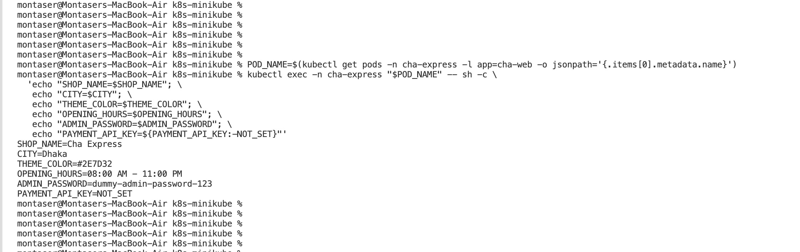


# Task 5: GitHub Copilot


## 1. Prompt Given to GitHub Copilot

The following prompt was provided to GitHub Copilot Chat (in VS Code) to generate both manifests:

> *"Generate a Kubernetes Deployment and NodePort Service YAML for an Nginx app (`nginx:1.25-alpine`) in the `cha-express` namespace with 3 replicas. Load all keys from ConfigMap `cha-config` as environment variables, mount its `index.html` key to `/usr/share/nginx/html/index.html`, inject only `ADMIN_PASSWORD` from Secret `cha-secret` as an env var, set CPU and memory requests/limits, and expose the app on NodePort `30080`."*

---

## 2. Raw Output Generated by GitHub Copilot

> *"The request is already implemented in cha-deployment.yaml and cha-service.yaml."*


## No change required, as the deployment and service was exposed on nodeport manuallly.


# Task 6: Rolling Update & Rollback


## 1. Update Image to `nginx:1.27-alpine` and Record the Change

First, annotate the initial revision (Revision 1) so its rollout history has a clear change cause:

```bash
kubectl annotate deployment/cha-web -n cha-express kubernetes.io/change-cause="Initial deployment with nginx:1.25-alpine"
```


Update the container image to nginx:1.27-alpine, record the reason in kubernetes.io/change-cause, and watch the rolling update progress in real time:


```bash
kubectl set image deployment/cha-web nginx=nginx:1.27-alpine -n cha-express
kubectl annotate deployment/cha-web -n cha-express kubernetes.io/change-cause="Upgrade nginx image from 1.25-alpine to 1.27-alpine"

# Watch the rollout progress live
kubectl rollout status deployment/cha-web -n cha-express
kubectl get pods -n cha-express -l app=cha-web -w
```

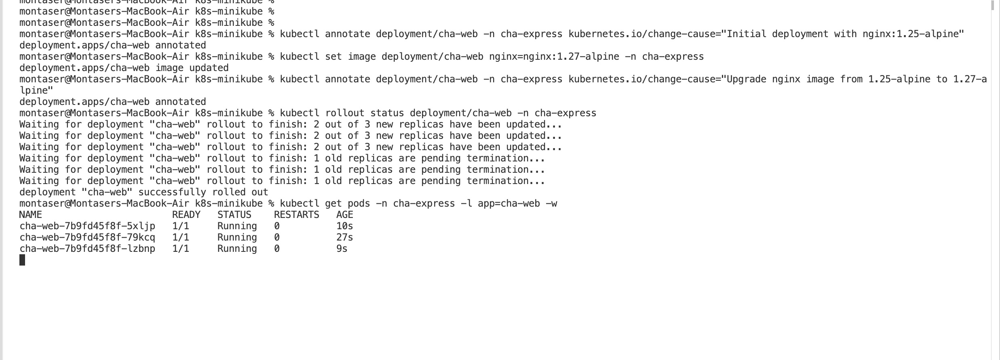

## 2. View Rollout History with Recorded Reasons

Inspect the revision history of cha-web:

```bash
kubectl rollout history deployment/cha-web -n cha-express
```

To inspect the exact image and pod template details of a specific revision (for example, Revision 2):

```bash
kubectl rollout history deployment/cha-web -n cha-express --revision=2
```

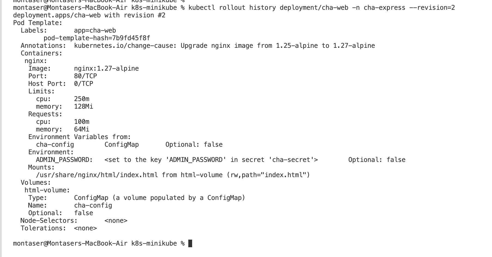

## 3. Deploy an Invalid Image Tag and Restore the Previous Working Version

### Step A: Trigger a broken rollout (`nginx:invalid-tag-999`)

Update the deployment to a non-existent image tag and record the change cause:

```bash
kubectl set image deployment/cha-web nginx=nginx:invalid-tag-999 -n cha-express
kubectl annotate deployment/cha-web -n cha-express kubernetes.io/change-cause="Deploy broken image tag nginx:invalid-tag-999"
```

Check pod status to observe the stalled rollout (ImagePullBackOff / ErrImagePull):

```bash
kubectl get pods -n cha-express -l app=cha-web
```

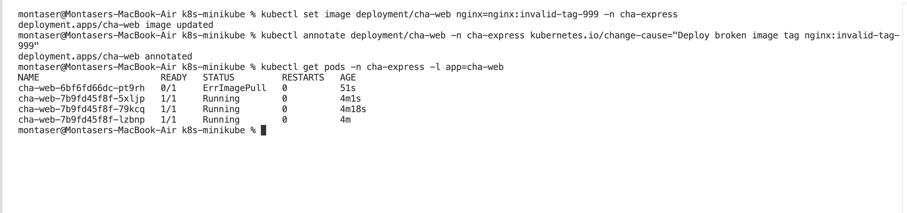

### Step B: Roll back to the previous working revision (`nginx:1.27-alpine`)

Undo the failed rollout and verify that all 3 replicas return to a healthy state:

```bash
kubectl rollout undo deployment/cha-web -n cha-express
kubectl rollout status deployment/cha-web -n cha-express
kubectl get pods -n cha-express -l app=cha-web
kubectl rollout history deployment/cha-web -n cha-express
```

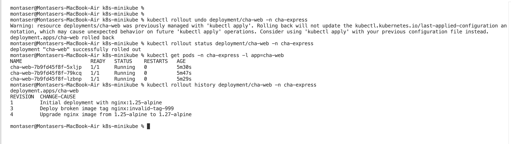

## 4. Question: Did the Website Go Down During the Update?

No, the website did not go down during either the valid upgrade (1.25-alpine → 1.27-alpine) or the broken image rollout (invalid-tag-999).

### Why it stayed online

The default `RollingUpdate` strategy uses `maxSurge: 25%` and `maxUnavailable: 25%`:

For a Deployment with replicas: 3, Kubernetes rounds 25% down to 0 for maxUnavailable (meaning at least 3 ready pods must remain available at all times) and rounds 25% up to 1 for maxSurge (allowing up to 4 total pods during the transition).

Kubernetes spins up a new pod first and waits until it passes readiness checks (1/1 Running) before terminating an old pod.

### Service endpoint filtering

The NodePort Service (cha-web-service) only routes incoming traffic to pods whose Ready condition is True.

When nginx:invalid-tag-999 failed with ImagePullBackOff, the new pod never became Ready, so Kubernetes halted replacement and kept all 3 existing nginx:1.27-alpine pods serving traffic without interruption.


# Task 7: Debug Challenge, "The Shop Is Closed!"

## 1. Bug Analysis & Resolution

### Bug 1: Invalid Container Image Tag (`nginx:1.27-alpinee`)

- **Symptom Observed:**  
  After applying the manifest, `kubectl get pods -n cha-express` shows the `cha-broken` pods stuck in `ErrImagePull` and `ImagePullBackOff` with `0/1` containers ready.
- **How It Was Identified:**  
  Inspected pod events using `kubectl describe pod <cha-broken-pod> -n cha-express`. The `Events` section reported:
  `Failed to pull image "nginx:1.27-alpinee": rpc error: code = NotFound ... manifest for nginx:1.27-alpinee not found`.
- **Root Cause:**  
  Typo in the image tag (`nginx:1.27-alpinee` with an extra `e` instead of `nginx:1.27-alpine`).
- **How It Was Fixed:**  
  Corrected `spec.template.spec.containers[0].image` from `nginx:1.27-alpinee` to `nginx:1.27-alpine`.

---

### Bug 2: Misspelled ConfigMap Reference (`cha-confg`)

- **Symptom Observed:**  
  Once the image tag is corrected (or observed alongside image events), pods fail container startup with status `CreateContainerConfigError` and `0/1` ready.
- **How It Was Identified:**  
  Ran `kubectl describe pod <cha-broken-pod> -n cha-express` and checked `kubectl get configmaps -n cha-express`. The pod events showed `Error: configmap "cha-confg" not found`, whereas the actual ConfigMap in the namespace is named `cha-config`.
- **Root Cause:**  
  Typo in `envFrom[].configMapRef.name` (`cha-confg` missing the letter `i` instead of `cha-config`).
- **How It Was Fixed:**  
  Updated `configMapRef.name` from `cha-confg` to `cha-config`.

---

### Bug 3: Service Label Selector Mismatch (`app: cha-brokn`)

- **Symptom Observed:**  
  Even after the `cha-broken` pods reach `1/1 Running`, requests to `cha-broken-svc` fail with connection refused / no route to host, and the Service has no backend endpoints attached.
- **How It Was Identified:**  
  Ran `kubectl get endpoints cha-broken-svc -n cha-express` (or `kubectl describe svc cha-broken-svc -n cha-express`), which returned `<none>` for `ENDPOINTS`. Comparing `kubectl get pods -n cha-express --show-labels` (`app=cha-broken`) against the Service selector (`app=cha-brokn`) revealed the mismatch.
- **Root Cause:**  
  Typo in the Service's `spec.selector.app` field (`cha-brokn` missing the letter `e`), so it did not match the pod template label `app: cha-broken`.
- **How It Was Fixed:**  
  Updated `spec.selector.app` in `cha-broken-svc` from `cha-brokn` to `cha-broken`.

---

### Bug 4: Incorrect Service `targetPort` (`8080` instead of `80`)

- **Symptom Observed:**  
  With the Service endpoints populated (`<pod-ip>:8080`), curling or accessing `cha-broken-svc` on port `80` still returns `Connection refused` (`Failed to connect to cha-broken-svc port 80: Connection refused`).
- **How It Was Identified:**  
  Checked `kubectl describe svc cha-broken-svc -n cha-express` (`TargetPort: 8080/TCP`) and verified the port Nginx actually listens on inside the pod via `kubectl exec -n cha-express <cha-broken-pod> -- netstat -tlnp` (or `ss -tlnp`), confirming Nginx listens on port `80`, not `8080`.
- **Root Cause:**  
  The default `nginx:1.27-alpine` image listens on container port `80`, but `cha-broken-svc` forwarded traffic to `targetPort: 8080` where nothing was listening.
- **How It Was Fixed:**  
  Changed `spec.ports[0].targetPort` in `cha-broken-svc` from `8080` to `80` (and explicitly declared `containerPort: 80` on the container spec for clarity).

---

## 2. Corrected Manifest (`cha-fixed.yaml`)

```yaml
apiVersion: apps/v1
kind: Deployment
metadata:
  name: cha-broken
  namespace: cha-express
spec:
  replicas: 2
  selector:
    matchLabels:
      app: cha-broken
  template:
    metadata:
      labels:
        app: cha-broken
    spec:
      containers:
      - name: web
        image: nginx:1.27-alpine
        ports:
        - containerPort: 80
        envFrom:
        - configMapRef:
            name: cha-config
---
apiVersion: v1
kind: Service
metadata:
  name: cha-broken-svc
  namespace: cha-express
spec:
  selector:
    app: cha-broken
  ports:
  - port: 80
    targetPort: 80
```

## 3. Verification Commands
   
```bash
kubectl apply -f cha-fixed.yaml

# 1. Confirm both pods are Running and Ready (1/1)
kubectl get pods -n cha-express -l app=cha-broken

# 2. Confirm Service endpoints map to <pod-ip>:80
kubectl get endpoints cha-broken-svc -n cha-express

# 3. Test HTTP response from inside the cluster
kubectl run curl-test --rm -it --restart=Never --image=curlimages/curl -n cha-express -- http://cha-broken-svc
```


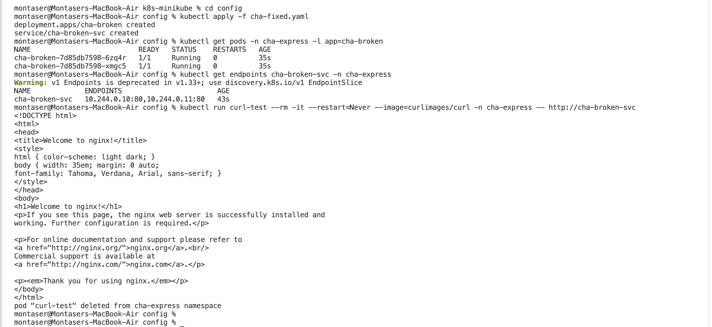


# Bonus

# ConfigMap Live Updates: Volume Mounts vs. Environment Variables

### 1. Update `THEME_COLOR` and `index.html` in `cha-config2.yaml`


[View cha-config2.yaml](./config/cha-config2.yaml)

New yaml file `cha-config2.yaml` (for example, changing `THEME_COLOR` from `#2E7D32` to `#B71C1C` and updating the heading/prices in `index.html`), then apply it:

```bash
kubectl apply -f cha-config2.yaml
```


### 2. Observe What Changes in the Running Pods
Check both the environment variable and the served index.html inside a running cha-web pod without restarting it:

```bash
POD_NAME=$(kubectl get pods -n cha-express -l app=cha-web -o jsonpath='{.items[0].metadata.name}')

# 1. Check THEME_COLOR environment variable inside the container
kubectl exec -n cha-express "$POD_NAME" -- printenv THEME_COLOR

# 2. Check the served index.html content inside the container
kubectl exec -n cha-express "$POD_NAME" -- cat /usr/share/nginx/html/index.html
```


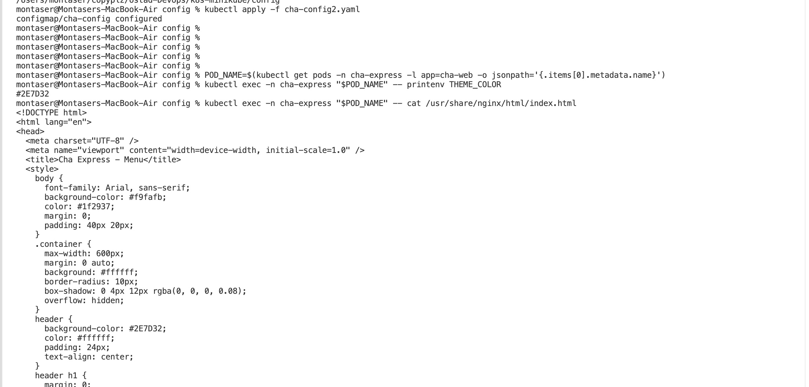

### 3. Question: Why Do the Two Behave Differently, and How Do You Apply All Changes?
Why They Behave Differently
Environment Variables (THEME_COLOR) Are Resolved Only at Container Startup:
Linux process environment variables are injected into the container's process space by the container runtime when the container starts.
Kubernetes has no mechanism to hot-inject updated environment variables into an already-running process, so THEME_COLOR remains frozen at #2E7D32 for the entire lifetime of the pod.
ConfigMap Volume Mounts (index.html) Are Synced by kubelet—Except When Using subPath:
Standard Volume Mount (Directory Mount): When a ConfigMap is mounted as a directory volume, kubelet periodically syncs ConfigMap updates (controlled by syncFrequency, default 1 minute) by atomically swapping a hidden ..data symlink inside the mounted directory. Nginx reads /usr/share/nginx/html/index.html fresh from disk on each HTTP request, so the updated HTML appears automatically without restarting the pod.
subPath Caveat: Because our cha-web Deployment mounted index.html using subPath: index.html, Kubernetes bind-mounts the specific file inode directly rather than tracking the ..data directory symlink. As a result, a ConfigMap volume moun


